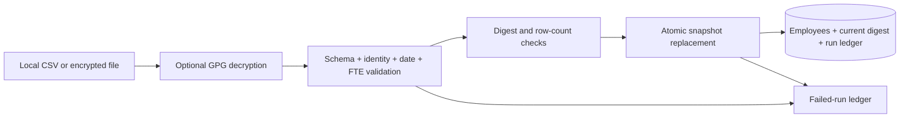

# Workforce ingestion pipeline

**A failed refresh should leave yesterday's valid dataset available.**

This project validates a fictional workforce snapshot, rejects malformed or suspicious inputs, and publishes the entire replacement in one database transaction. A run ledger records successes, unchanged inputs, and validation/publication failures without storing row contents in error messages.

## Try it in one minute

Requires Python 3.9+ with SQLite. The default demo has no dependencies or external services.

```bash
python3 workforce_pipeline.py
python3 -m unittest discover -s tests -v
```

The demo publishes four invented employees. All display names explicitly identify synthetic people. To demonstrate replay against a persistent database:

```bash
python3 workforce_pipeline.py --db workforce-demo.db
python3 workforce_pipeline.py --db workforce-demo.db
```

The second run reports `unchanged`. Temporary databases and decrypted files are excluded from Git.

## Architecture



## Guarantees demonstrated

- Schema mismatch, empty snapshots, duplicate IDs, invalid dates, and invalid/non-finite FTE values are rejected.
- A row-count decrease greater than 25% is rejected by default. `--max-drop-fraction` makes an intentional override explicit.
- Validation completes before target replacement. The delete, insert, current digest, and success audit share one transaction.
- A database error during insertion rolls back the deletion and any partial inserts.
- Replaying the current input is a no-op for employee data, with an additional run entry.
- The CLI returns a nonzero exit code on failure, so a scheduler can detect it.

The guard checks total row count, not business-level correctness. A same-size but incorrect dataset still requires richer quality rules.

## Optional encrypted input

The loader supports `.gpg` and `.pgp` input using an externally installed `gpg` executable and a caller-managed keyring:

```bash
python3 workforce_pipeline.py --input /path/to/synthetic-snapshot.csv.gpg --gpg-home /path/to/demo-keyring --db workforce-demo.db
```

Decryption uses a private temporary directory, captures GPG diagnostics, times out after 60 seconds, and removes the temporary plaintext on normal exit. The operating system can retain recoverable disk blocks; this is not secure erasure. Passphrases are not accepted as CLI arguments. Key provisioning and GPG-agent setup are outside this example.

**GPG decryption is optional and has not been validated against a real keyring in this development environment.** The default CSV path and transaction behavior are tested. SFTP download, scheduler integrations, and SQL Server/Snowflake adapters are not implemented here.

## Engineering tradeoffs

The full input is validated in memory to keep the example clear. Large feeds would need bounded staging and transactional promotion. SQLite makes rollback behavior reproducible without a managed database. It does not establish performance or availability guarantees for another database engine.

Publication history distinguishes the current digest from previously seen digests: returning to an older snapshot after another publication is a new publication, not an incorrect replay skip. Input freshness itself is not enforced; a production feed needs a signed/versioned manifest or a trusted source sequence.

## Scope and provenance

This newly authored portfolio example is inspired by operational ingestion experience. It includes only invented data and generic rules, with no employer code, real employee records, source credentials, internal paths, or original Git history. The safety improvements are features of this portfolio implementation, not claims about an earlier production system.

See [design notes](docs/design.md) and [verification](docs/verification.md).

## License

[MIT License](LICENSE) — Copyright (c) 2026 Shane Warnakula.
